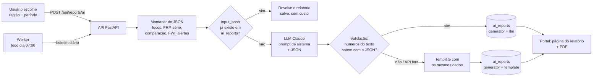

# IGNIS — O que apresentar ao professor

> Material de apoio para a conversa de acompanhamento da 3ª fase (entrega em **07/11/2026**).
> Objetivo: mostrar que o sistema **não é só um mapa**. A tela atual é a ponta visível de um
> pipeline de dados que já funciona. Mostrar também, com detalhes, **como vai funcionar o relatório
> por IA (RF11)** e o boletim diário (RF07).

---

## 1. A mensagem principal

O mapa é só a primeira tela. Por baixo dele já funcionam:

| Camada | Estado | O que dá para mostrar |
|---|---|---|
| Coleta automática NASA FIRMS (RF01, RF02, RNF01, RNF02) | ✅ pronto | Worker de hora em hora, ~226 mil focos reais desde 01/07, rate limiter, tabela `collection_runs` |
| Índice de perigo FWI do EFFIS/GWIS (RF03) | ✅ pronto | `GET /api/fwi` com a série diária e a previsão de D+1 a D+3 por região |
| Interpretação (clusters, densidade, criticidade) | ✅ pronto | Cores e raios do mapa, popup do cluster |
| API pública (RF04, RF05, RF08) | ✅ quase pronto | Swagger em `/docs`: focos GeoJSON, série, ranking, área queimada estimada, histórico paginado e CSV |
| Admin de regiões (RF09) | ✅ backend | Login JWT + CRUD de regiões: uma região nova passa a ser coletada no ciclo seguinte (RNF05) |
| Alertas (RF06, RF10, RNF04) | 🟡 modelado | Tabelas prontas (regras, eventos append-only, assinantes com consentimento) |
| **Relatório por IA (RF11) e boletim (RF07)** | 🟡 **modelado** | Tabelas `ai_reports` e `bulletins` prontas; o desenho está na seção 3 |
| Telas restantes (histórico, boletins, alertas, admin) | ⬜ etapa 7 | Wireframes na seção 5 |

> **Frase para abrir:** "O que vocês veem é o mapa, mas o sistema já coleta, guarda, deduplica e
> interpreta os focos de hora em hora, já cruza com o índice de perigo do EFFIS e já expõe tudo
> numa API documentada. O relatório por IA consome exatamente esses dados."

---

## 2. Roteiro de demonstração (≈ 10 min)

1. **Mapa** (`frontend`): trocar de região (Mediterrâneo, Grécia, Califórnia), mudar o período e
   abrir o popup de um cluster. Explicar que a cor é a criticidade relativa e o raio é proporcional
   ao FRP (a potência do fogo).
2. **Tendências**: série de 90 dias e ranking por país. **Clicar num dia do gráfico** faz o mapa
   mostrar aquele dia (consulta ao histórico, RF08).
3. **Swagger** (`http://127.0.0.1:8000/docs`): mostrar os endpoints que ainda não têm tela:
   - `/api/fwi?region=grecia`: índice de perigo com previsão;
   - `/api/stats/burned-area`: área queimada estimada e as limitações do método;
   - `/api/history.csv`: exportação;
   - `/api/admin/regions`: login e cadastro de região.
4. **Saúde e coleta**: `/health` e `/api/collection/status` (última coleta, transações gastas da
   cota FIRMS).
5. **Relatórios IA** (aba no cabeçalho, demonstração com dados fixos): clicar em *Gerar
   relatório* mostra o passo a passo da seção 3 (montar JSON → cache → IA → validação → salvar).
   Gerar de novo mostra o reaproveitamento por cache. Marcar *Simular IA indisponível* mostra o
   fallback por template. No relatório, os números destacados em verde são os conferidos com o
   JSON (passe o mouse). *Exportar PDF* imprime só o documento.
6. **Alertas** (aba no cabeçalho, demonstração com dados fixos): *Simular coleta com alerta* roda a
   avaliação das regras, grava o evento na auditoria e mostra o e-mail enviado. *Ver o alerta no
   mapa* voa até a Ática com um marcador pulsando. Rodar de novo mostra o cooldown impedindo alerta
   repetido. Atalho: **Shift+A** em qualquer tela dispara o alerta direto no mapa.
7. **Qualidade**: `pytest` rodando, cobertura e a tabela de rastreabilidade
   (`docs/rastreabilidade.md`), que liga cada requisito ao código e aos testes.

---

## 3. Como vai funcionar o relatório com IA (RF11 + RF07)

### 3.1 Princípio: **o sistema calcula, a IA só redige**

O maior risco de usar um LLM num sistema de apoio à decisão é ele **inventar números**. Por isso a
IA nunca consulta o banco nem faz contas. Todo número vem de um JSON montado pelo backend com as
mesmas consultas que alimentam os gráficos. O LLM só transforma esse JSON em texto para leigos.



### 3.2 Passo a passo

**1. Entrada.** O usuário escolhe a região e o período na tela "Boletins" (ex.: Grécia, últimos 7
dias). O boletim diário é disparado pelo worker sem ninguém pedir.

**2. Montagem do JSON estruturado.** O backend reaproveita o que já existe (`/stats/daily`,
`/stats/ranking`, `/fwi`, interpretação) e gera algo assim (valores ilustrativos):

```json
{
  "regiao": "Grécia",
  "periodo": { "inicio": "2026-10-15", "fim": "2026-10-21", "dias": 7 },
  "fontes": ["NASA FIRMS (VIIRS/MODIS, NRT)", "EFFIS/GWIS (FWI)"],
  "focos": {
    "total": 1284,
    "alta_confianca": 611,
    "frp_total_mw": 48210.5,
    "frp_max_mw": 912.3,
    "serie_diaria": [
      { "data": "2026-10-15", "focos": 96 },
      { "data": "2026-10-21", "focos": 312 }
    ]
  },
  "comparacao_periodo_anterior": { "total_anterior": 540, "variacao_pct": 137.8 },
  "agrupamentos_mais_criticos": [
    { "local_aproximado": "Ática", "focos": 214, "frp_total_mw": 15320.0, "criticidade": "alta" }
  ],
  "area_queimada_estimada_km2": 31.6,
  "fwi": {
    "media_periodo": 38.4,
    "classe_hoje": "very_high",
    "previsao": [{ "data": "2026-10-22", "classe": "extreme" }]
  },
  "alertas_disparados": [
    { "regra": "Mais de 200 focos em 24h", "valor": 312, "limiar": 200, "em": "2026-10-21T14:00Z" }
  ],
  "dados_atualizados_em": "2026-10-21T18:05Z"
}
```

**3. Cache por `input_hash`.** O JSON é normalizado e passa por SHA-256. Se a tabela `ai_reports`
já tem um relatório com o mesmo hash, ele é devolvido sem nova chamada à IA. Isso evita custo e
torna a resposta instantânea quando muita gente abre o mesmo boletim, algo comum numa emergência.

**4. Chamada ao LLM.** Usamos o SDK oficial da Anthropic. O modelo fica em `LLM_MODEL` e a chave em
`ANTHROPIC_API_KEY`, ambos no `.env` do servidor. A chave **nunca vai para o frontend**. O prompt de
sistema tem regras fixas:

```text
Você é redator de boletins de situação sobre incêndios florestais para o público leigo.
Regras:
1. Use SOMENTE os números presentes no JSON fornecido. Não estime, não arredonde
   de forma diferente e não acrescente dados externos.
2. Cite o período analisado e as fontes (NASA FIRMS e EFFIS).
3. Escreva em português do Brasil, frases curtas, sem jargão. Explique FRP como
   "intensidade do fogo" e FWI como "risco de incêndio pelas condições do tempo".
4. Estrutura: Resumo (2 frases) · Onde está o fogo · Evolução · Risco nos próximos dias
   · Alertas.
5. Não dê ordens de evacuação; oriente a seguir a defesa civil local.
6. Termine com: "Texto gerado por IA a partir de dados de satélite. Pode conter
   imprecisões. Dados atualizados em {dados_atualizados_em}."
```

**5. Validação pós-geração.** Antes de salvar, o backend extrai todos os números do texto (regex) e
confere se cada um aparece no JSON, com tolerância para o arredondamento (ex.: 48210,5 → "48 mil").
Datas e o ano não entram na conta.
- Todos batem → salva com `generator = llm`.
- Algum número não aparece no JSON → tenta **uma** nova geração. Se falhar de novo → usa o template.
- O resultado da checagem fica em `ai_reports.validation`, para auditoria.

**6. Fallback por template.** Se a API da Anthropic estiver fora, sem crédito, lenta (timeout) ou se
a validação reprovar, o sistema gera o boletim por um **template em Python** com os mesmos dados
("Entre 15/10 e 21/10 foram detectados 1.284 focos na Grécia, 137,8% a mais que na semana
anterior…"). O portal **nunca fica sem boletim** (RNF06).

**7. Persistência e auditoria.** Cada relatório guarda a entrada (JSON), a saída, o modelo, quem
gerou (LLM ou template), o resultado da validação, os tokens gastos e a data. Assim dá para
responder "de onde saiu esse número?" a qualquer momento.

**8. Publicação (RF07).** O worker gera um boletim por região todo dia. Cada um fica numa tabela
`bulletins` ligada ao relatório e ganha **página permanente** (`/boletins/2026-10-21/grecia`) e
**exportação em PDF**.

### 3.3 Exemplo do texto que sai

> **Boletim de situação: Grécia, 15 a 21 de outubro de 2026**
>
> **Resumo.** Os satélites detectaram 1284 focos de calor na Grécia nos últimos 7 dias, 137,8% a
> mais que na semana anterior. O risco de incêndio pelas condições do tempo está *muito alto* e
> deve chegar a *extremo* amanhã.
>
> **Onde está o fogo.** A maior concentração está na região da Ática, com 214 focos…
>
> **Alertas.** Em 21/10 o número de focos em 24 horas (312) passou o limite de 200…
>
> *Texto gerado por IA a partir de dados de satélite (NASA FIRMS, EFFIS). Pode conter
> imprecisões. Dados atualizados em 21/10/2026, 18:05 UTC.*

### 3.4 Por que esse desenho (argumentos para o professor)

| Preocupação | Resposta do projeto |
|---|---|
| "A IA pode inventar dados" | Ela não tem acesso a dados além do JSON, e a validação confere cada número |
| "E se a IA sair do ar?" | Fallback por template: mesmo conteúdo, texto menos fluido |
| "Quanto custa?" | 1 boletim por região por dia + cache por hash. Em poucas regiões, são dezenas de chamadas por mês |
| "Como auditar?" | `ai_reports` guarda entrada, saída, modelo e validação de cada geração |
| "Segurança da chave" | Só no `.env` do servidor; o frontend chama a nossa API, nunca a da Anthropic |
| "Transparência para o cidadão" | Aviso fixo de texto gerado por IA, fontes e horário dos dados em todo boletim |
| "Onde entra no RADIAN?" | Camada de **disseminação**: transforma o dado interpretado em informação para o público |

---

## 4. Como vão funcionar os alertas (RF06, RF10, RNF04)

1. Após cada coleta (de hora em hora), o motor avalia as regras ativas de cada região. Exemplos:
   "mais de 200 focos em 24h", "FRP máximo acima de 500 MW".
2. Se a regra estoura e não está em *cooldown* (ex.: 12h), o motor grava um `alert_event` (tabela
   **append-only**: um trigger no banco impede alterar ou apagar) e notifica os assinantes por
   e-mail e/ou webhook.
3. **LGPD:** a assinatura guarda só o e-mail e as regiões escolhidas, com aceite registrado (data e
   versão do termo) e **double opt-in**. Toda mensagem tem link de descadastro, existe um endpoint
   de exclusão definitiva e os e-mails nunca vão para os logs em texto claro.
4. Os alertas disparados entram no JSON da IA, então o boletim cita os alertas do período.

---

## 5. Telas que faltam (etapa 7)

```text
┌─ Portal público ────────────────────────────────────────────┐
│ [Mediterrâneo ▾] [24h|48h|72h]  Dados atualizados há 40 min │
│ ┌────────────┐ ┌────────────┐ ┌────────────────────────┐   │
│ │ 1.284 focos│ │ Mais afet.:│ │ Risco hoje: MUITO ALTO │   │
│ │ nas 24h    │ │ Grécia     │ │ (FWI 38) ▲ amanhã      │   │
│ └────────────┘ └────────────┘ └────────────────────────┘   │
│ ┌──────────────── mapa (pontos / heatmap) ───────────────┐ │
│ └────────────────────────────────────────────────────────┘ │
│ Boletim do dia (IA) ─ resumo + "ler completo" + PDF        │
└─────────────────────────────────────────────────────────────┘

┌─ Boletins ──────────────────────────────────────────────────┐
│ Região [Grécia ▾]  De [15/10] Até [21/10]  [Gerar com IA]  │
│ ── 21/10 Grécia · gerado por IA ✓ validado · [PDF]         │
│ ── 20/10 Grécia · template (IA indisponível) · [PDF]       │
└─────────────────────────────────────────────────────────────┘
```

Também faltam as telas de **Histórico** (tabela paginada + CSV, a API já existe), **Receber
alertas** (formulário com consentimento), **Privacidade** e **Admin** (regiões, regras, histórico
de alertas, status das coletas).

---

## 6. Cronograma até 07/11

| Período | Entrega |
|---|---|
| 22/10 – 26/10 | Etapa 6: JSON de entrada, cliente Anthropic, validação, template, `POST /api/reports/ai`, boletim diário |
| 27/10 – 30/10 | Etapa 5: motor de alertas, e-mail, assinatura com double opt-in |
| 31/10 – 04/11 | Etapa 7: telas de boletins, histórico, alertas, admin, cartões e FWI no portal |
| 05/11 – 07/11 | Etapa 8: Nginx + Compose completo, acessibilidade, deploy no servidor da UDESC |

Cortes já previstos se o prazo apertar (em `docs/pendencias.md`): PDF por CSS de impressão, só
e-mail sem webhook, sem desenho de bbox no admin, frontend em JSX em vez de TypeScript.

---

## 7. Perguntas prováveis e respostas curtas

- **"É tempo real?"** Não. É *quase* tempo real: a NASA publica com cerca de 3h de atraso e a
  coleta roda de hora em hora (RNF01). A interface nunca diz "tempo real".
- **"Por que não treinar um modelo próprio de previsão?"** Está fora do escopo. Usamos o FWI
  oficial do EFFIS, que já é a referência europeia. A IA generativa entra na *comunicação*, não na
  previsão.
- **"Todo foco de calor é incêndio?"** Não: pode ser queima agrícola ou indústria. Por isso
  mostramos a confiança do sensor, agrupamos focos próximos e calculamos a criticidade.
- **"Como adicionar uma região?"** Pelo admin (já funciona na API). A coleta, o ranking e os
  alertas iteram sobre a tabela de regiões, sem mudar código (RNF05).
- **"E se a coleta ou a IA caírem?"** `/health` indica o problema. O portal continua servindo o
  último dado e o último boletim, com o horário visível. A IA cai para o template.
- **"Qual modelo de IA?"** Claude, da Anthropic. O modelo é configurável por variável de ambiente,
  então dá para trocar por um mais barato ou mais capaz sem mexer no código.

---

## 8. Decisões que dependem do professor ou da UDESC

1. **Servidor da UDESC:** tem Docker? domínio/HTTPS? portas liberadas? SMTP institucional para os
   alertas?
2. **Créditos de IA:** quem fornece a `ANTHROPIC_API_KEY`? Sem ela, o sistema funciona só com o
   template, o que já cumpre o RF07, mas não o RF11.
3. **Escopo do ranking:** incluir focos fora dos 5 países (Norte da África, Bálcãs, Turquia)?
